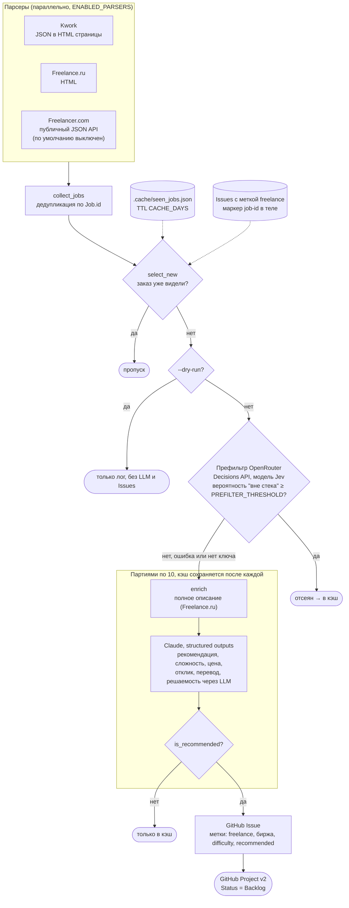

# freelance-parser

> **In English.** A personal Python tool that scrapes freelance marketplaces (Kwork, Freelance.ru,
> Freelancer.com), skips jobs it has already seen, pre-filters the rest with a cheap OpenRouter
> decision model and has Claude assess each remaining job. Recommended jobs become GitHub Issues
> in the Backlog column of a GitHub Project, with a suggested price and a draft reply. It runs
> hourly in GitHub Actions; the rest of this README is in Russian.

Парсит фриланс-биржи, отбирает подходящие заказы через Claude и складывает их
GitHub Issues в колонку **Backlog** проекта GitHub (Projects v2; репозиторий и номер проекта
задаются в настройках).
В каждом Issue: сведения о заказе, рекомендуемая цена, краткое описание, черновик отклика и оценка,
насколько заказ можно выполнить ИИ-агентом на Claude Sonnet 5.5 и Opus 5.5.
Заказы не на русском попадают в Issue в переводе (оригинал — под спойлером); отклик остаётся на языке заказа.

## Источники

| Биржа | Статус |
|---|---|
| Kwork.ru | работает (категория «Разработка и IT») |
| Freelance.ru | работает (+ догрузка полного описания) |
| Freelancer.com | работает (публичный API, навыки Python/JS/Node/Go/TS/React), по умолчанию выключен — см. `ENABLED_PARSERS` |
| Upwork | не подключён: Cloudflare-челлендж; возможен только официальный API с OAuth |
| Fiverr | не подходит: витрина услуг, а не лента заказов |
| Хабр Фриланс | закрыт |

## Как работает



`main.py`: парсеры (параллельно) → отсев уже виденных (кэш + существующие Issues) →
префильтр через OpenRouter (если задан `OPENROUTER_API_KEY`) →
(по умолчанию все новые; `MAX_JOBS_PER_RUN` > 0 ограничивает их число) → партиями по 10: догрузка описаний →
Claude → Issues в Backlog, после каждой партии кэш сохраняется.
Префильтр — decision-модель Jev (`PREFILTER_MODEL`, по умолчанию `~typesafe/jev-latest`) через
OpenRouter Decisions API: по каждому заказу возвращает вероятность, что он явно вне стека (дизайн,
копирайтинг, PHP и т. п.). Заказы с вероятностью не ниже `PREFILTER_THRESHOLD` (по умолчанию 0.8)
отсеиваются до Claude, пишутся в лог и попадают в кэш. При ошибке OpenRouter или непонятном ответе
заказ идёт в Claude как обычно. Обычные чат-модели в `PREFILTER_MODEL` не подходят.
Нерекомендованные заказы Issues не создают, но попадают в кэш, чтобы не анализироваться повторно.

## Пример Issue

Пример с вымышленным заказом — настоящих заказов и заказчиков здесь нет. Разметка — как в шаблоне
из `github_integration.build_payload`.

Заголовок: `[Kwork] Telegram-бот для записи клиентов в автосервис`.
Метки: `freelance`, `kwork`, `difficulty:medium`, `recommended`.

> **Статус анализа**: Рекомендуется ✅ (релевантность 85%)
>
> ## Основная информация
> - Платформа: Kwork
> - Бюджет заказчика: 15000 RUB
> - Сложность: medium
> - Ссылка: [Открыть заказ](https://kwork.ru/projects/0000000)
> - Опубликован: 2026-10-07 13:30 UTC+04:00
>
> ## Описание задачи
> Нужен Telegram-бот для автосервиса: клиент выбирает услугу, дату и свободное время, получает
> напоминание за день до визита. Администратор видит записи в Google Таблице и может отменить
> запись командой в боте. Хостинг есть (VPS, Ubuntu).
>
> ## Технологии
> - Python
> - aiogram
> - Google Sheets API
> - SQLite
>
> ## Рекомендуемая цена
> 18000 RUB
>
> Задача целиком в стеке (Python, боты, интеграция с Google Sheets), ТЗ понятное. Бюджет немного
> ниже объёма работ: запись, напоминания и админ-команды — это 3–4 дня.
>
> ## Решаемость через LLM
> - Claude Sonnet 5.5: 80%
> - Claude Opus 5.5: 90%
>
> Человеку останется получить доступ к Google Таблице и VPS заказчика и проверить бота на
> реальных записях.
>
> ## Черновик отклика
> ```
> Здравствуйте! Сделаю бота на Python (aiogram): выбор услуги и времени, напоминание за день,
> записи в Google Таблице, отмена командой для администратора. Разверну на вашем VPS.
>
> Два вопроса: сколько мастеров принимают одновременно и нужно ли клиенту самому переносить запись?
> ```

В начале тела Issue стоит скрытый маркер `<!-- job-id: kwork_0000000 -->` — по нему заказ не
создаётся повторно. Для заказа не на русском в Issue идёт перевод, а оригинал — под спойлером.

## Запуск локально

```bash
cp .env.example .env     # заполнить GITHUB_TOKEN (repo + project), GITHUB_REPO, GITHUB_PROJECT_ID и ANTHROPIC_API_KEY
uv sync
uv run python main.py --dry-run   # только парсинг и отбор, без LLM и Issues
uv run python main.py             # полный цикл
```

Токен из `claude setup-token` — OAuth (`sk-ant-oat…`), анализатор подставляет его как `auth_token`.

## Ручная проверка LLM (тратит лимиты!)

```bash
uv run python scripts/try_analyzer.py kwork 3
```

Префильтр OpenRouter (печатает сырой ответ модели и решения):

```bash
uv run python scripts/try_prefilter.py kwork 10
```

Запускается только вручную; в тесты и CI не входит.

## Тесты

```bash
uv run pytest        # без сети и без LLM
```

## GitHub Actions

Два workflow:

- `ci.yml` — на каждый push/PR гоняет офлайн-тесты; на push в `main` после зелёных тестов (если задана переменная репозитория `PUBLISH_IMAGE=true`)
  собирает Docker-образ и публикует в `ghcr.io/<владелец>/<репозиторий>` (`latest` и `<sha>`).
- `parser-cron.yml` — каждый час (и вручную, опции dry-run, `reset_cache` — запуск без кэша виденных заказов, и `analyzer_model` — модель Claude на этот запуск) запускает опубликованный образ через `docker run`.

Нужны секреты `GH_PAT` (scope `repo` + `project`) и `ANTHROPIC_API_KEY`; `OPENROUTER_API_KEY` — по желанию (префильтр). Первый запуск cron возможен
только после того, как `ci.yml` хотя бы раз опубликует образ. Локальная проверка образа:
`docker build -t freelance-parser . && docker run --rm freelance-parser --dry-run`.

Переменные репозитория (все необязательные): `ISSUES_REPO` (`owner/repo`, где создавать Issues;
по умолчанию — этот же репозиторий), `PROJECT_ID`, `PROJECT_OWNER`, `DEVELOPER_STACK`, `TIMEZONE`,
`ANALYZER_MODEL`, `ENABLED_PARSERS`, `LOG_JOB_TITLES`.

**Если репозиторий публичный**, Issues с текстами заказов и черновиками откликов видны всем.
Чтобы этого не было, заведите отдельный приватный репозиторий и укажите его в `ISSUES_REPO`
(токен `GH_PAT` должен иметь к нему доступ); проект при этом остаётся прежним. Логи запусков тоже
публичны, поэтому в Actions в них пишутся только ID заказов; названия включает `LOG_JOB_TITLES=true`.

## Настройки (.env)

`ANALYZER_MODEL` (модель Claude для анализа, по умолчанию `claude-haiku-4-5`; в GitHub Actions —
переменная репозитория `ANALYZER_MODEL` или поле при ручном запуске), `ANALYZER_CONCURRENCY`, `PREFILTER_MODEL`, `PREFILTER_THRESHOLD`, `MAX_JOBS_PER_RUN`, `CACHE_DAYS`, `SEEN_FILE`,
`ENABLED_PARSERS` (активные парсеры через запятую: `kwork`, `freelance_ru`, `freelancer`; по умолчанию
`kwork,freelance_ru` — Freelancer выключен; в проде задаётся переменной репозитория `ENABLED_PARSERS`),
`FREELANCE_RU_CATEGORIES` (категории ленты Freelance.ru через запятую, по умолчанию `4,724` —
«Веб-разработка и IT» и «ИИ и Нейросети»), `PARSER_TIMEOUT`, `LOG_LEVEL`, `TIMEZONE` (пояс для дат в Issues, по умолчанию `UTC+4`;
смещение или имя IANA, например `Europe/Samara`), `LOG_JOB_TITLES` (`false` — в логах только ID заказов).

GitHub: `GITHUB_REPO` (репозиторий для Issues), `GITHUB_PROJECT_ID` (номер проекта из его URL),
`GITHUB_PROJECT_OWNER` (по умолчанию владелец репозитория), `GITHUB_PROJECT_STATUS_FIELD` и
`GITHUB_PROJECT_STATUS_OPTION` (поле и колонка проекта, по умолчанию `Status` / `Backlog`),
`GITHUB_ISSUE_LABEL` (метка Issues, по умолчанию `freelance`; по ней же ищутся уже созданные).

Под себя: `DEVELOPER_STACK` (стек исполнителя — подставляется в промпты Claude и префильтра),
`KWORK_CATEGORY_ID` (категория Kwork, по умолчанию `41` — «Разработка и IT»; `0` — без фильтра),
`FREELANCER_SKILL_IDS` (id навыков Freelancer.com через запятую).

## Идеи на потом

- Upwork через официальный GraphQL API.
- Обучение на ваших решениях (закрытые/принятые Issues → примеры для промпта).
- Уведомления в Telegram/Slack о рекомендованных заказах.

## Оговорка

Это личный инструмент, сделанный под одного пользователя; он не связан с Kwork, Freelance.ru,
Freelancer.com, Anthropic или OpenRouter. Парсер читает только открытые ленты заказов без входа в
аккаунт и сам на заказы не откликается. Тот, кто его запускает, сам отвечает за соблюдение правил
и пользовательских соглашений бирж, за частоту запросов и за то, как хранит и использует тексты заказов.

## Лицензия

[MIT](LICENSE)
